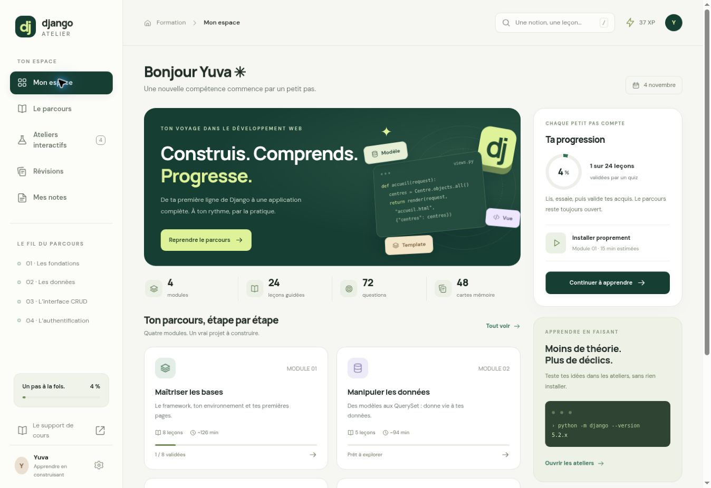

# Django Atelier

Un parcours interactif en français pour apprendre Django en construisant **Musculor**, le site d’un réseau de centres sportifs.

**[Ouvrir le site sur GitHub Pages](https://juba-3.github.io/django-atelier/)**



*La progression visible dans cet aperçu provient des essais de l’interface.*

## Le parcours

| Module | Thèmes | Leçons |
| --- | --- | ---: |
| Les fondations | MVT, environnement, projet, vues, templates et fichiers statiques | 8 |
| Les données | Modèles, QuerySet, administration, relations et migrations | 5 |
| L’interface CRUD | Afficher, créer, modifier et supprimer des centres | 4 |
| L’authentification | Utilisateurs, sessions, permissions et inscription | 7 |

**24 leçons, 24 exercices à compléter, 72 questions corrigées et 48 cartes mémoire.**

Chaque leçon associe des explications, des exemples de code, un exercice avec indice, un quiz et un espace de notes. Deux bonnes réponses sur trois permettent de valider une leçon ; le meilleur score est conservé.

## Les ateliers interactifs

- **MVT** : suivre une requête jusqu’à sa réponse et distinguer les deux scénarios de 404.
- **Terminal guidé** : préparer un environnement et un projet, avec des commandes pour Linux/macOS ou Windows PowerShell.
- **ORM** : filtrer et trier des centres fictifs, puis observer le QuerySet et le SQL pédagogique correspondants.
- **CRUD et permissions** : créer, modifier et supprimer des centres fictifs, puis comparer les actions autorisées selon le rôle.

Les ateliers sont des simulations en JavaScript. Ils n’exécutent pas de Python. Le code des leçons est prévu pour être essayé séparément dans un environnement Django.

## Lancer le site en local

L’application utilise HTML, CSS et JavaScript, sans installation de dépendances JavaScript ni étape de compilation.

Depuis la racine du dépôt, avec Python 3 installé :

```bash
python3 -m http.server 8000 --directory dist
```

Ouvrir ensuite **[http://localhost:8000](http://localhost:8000)**. Arrêter le serveur avec `Ctrl+C`.

Utiliser un serveur HTTP permet à l’application de charger `lessons.json`. Les polices web sont chargées depuis Google Fonts, avec des polices de secours.

## Publication sur GitHub Pages

GitHub Pages publie le contenu de la branche `gh-pages`, depuis le dossier `/(root)`. Sa racine contient les fichiers de `main/dist/` ainsi qu’un fichier `.nojekyll` vide.

Pour mettre le site à jour, reporter les fichiers actualisés de `main/dist/` à la racine de `gh-pages`, puis publier un commit sur cette branche. **Modifier `main/dist/` seul ne redéploie pas le site : la branche `gh-pages` doit aussi être actualisée.**

## Progression et notes

Les scores, notes, favoris et cartes acquises sont enregistrés dans le `localStorage` du navigateur. Les centres fictifs de l’atelier CRUD utilisent un stockage distinct.

Dans **Préférences**, l’export et l’import JSON permettent de transférer la progression entre navigateurs ou appareils. Il n’y a pas de synchronisation automatique. Une importation remplace la progression locale après confirmation.

## Organisation du code

| Fichier | Rôle |
| --- | --- |
| `dist/index.html` | Page d’entrée et chargement des ressources |
| `dist/app.js` | Navigation, leçons, quiz, cartes, notes et progression |
| `dist/lessons.json` | Contenu pédagogique, exercices et évaluations |
| `dist/workshops.js` | Les quatre simulations interactives |
| `dist/style.css` | Identité visuelle et interface responsive |
| `dist/workshops.css` | Styles des ateliers |
| `docs/django-atelier-apercu.jpg` | Aperçu de l’interface |

## Source pédagogique

Le plan est adapté du support **« Formation Django — Synapse Learners »**, fourni par l’utilisateur. Les explications et activités ont été reformulées, avec **Django 5.2** comme version de référence. Le support original n’est pas inclus dans ce dépôt.

- [Support fourni](https://drive.google.com/file/d/17fYSMde_wWMItya2s1-2tvjPaTu07Qpd/view)
- [Documentation officielle de Django 5.2](https://docs.djangoproject.com/fr/5.2/)

La page **« Le support de cours »** présente les repères dans le document et les précisions techniques apportées au parcours.
